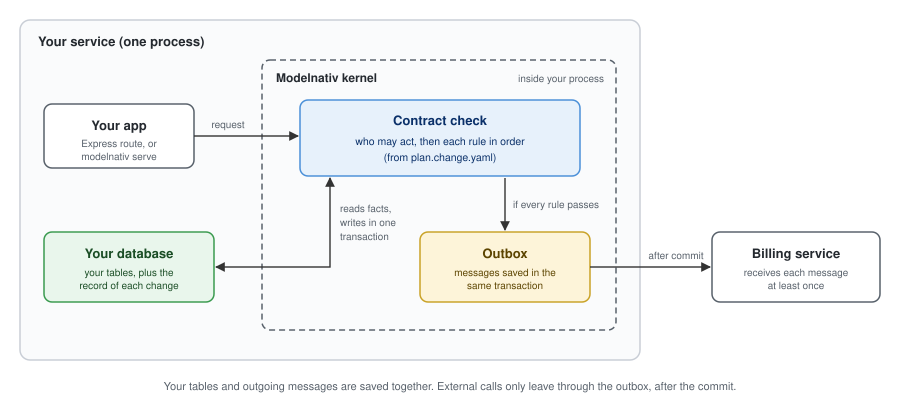
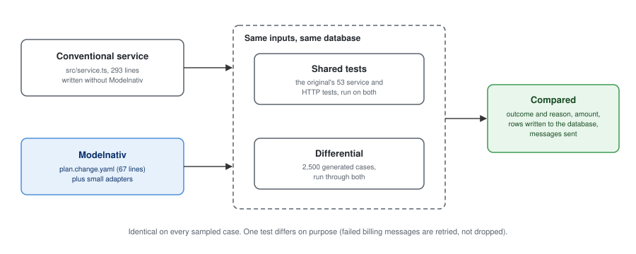
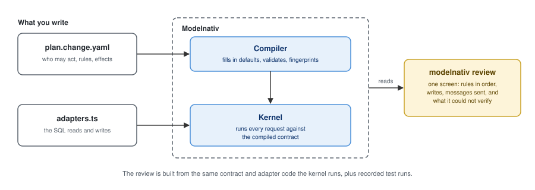

# Modelnativ

Modelnativ is a TypeScript framework for backend actions such as "change a subscription's plan" or "redeem loyalty points". You describe who may perform an action, which checks must pass and in what order, in a short YAML file; the framework checks every request against that file and saves the resulting database changes and outgoing messages in one transaction.

This repository contains the whole framework, a realistic example implemented twice (once as ordinary TypeScript, once with Modelnativ) with the tests that compare the two, and the documentation. It is an early **developer preview**, not production software; see [what is verified and what is not](docs/limitations.md).

| Package | Responsibility |
| --- | --- |
| [`contract-schema`](packages/contract-schema), [`contract-compiler`](packages/contract-compiler) | The YAML contract format, its validation, and the expansion of the short form into the full form |
| [`gate`](packages/gate) | Decides whether a request may proceed: who is calling, where each value came from, and each rule in order |
| [`runtime`](packages/runtime) | The kernel that runs requests, the building blocks for database reads and writes (`sqlRead`, `sqlEffect`), and the development HTTP server |
| [`effect-executor`](packages/effect-executor) | The commit transaction, duplicate-request handling, and the outbox that delivers outgoing messages |
| [`core`](packages/core) | The SDK for using Modelnativ inside an existing Express or Node service |
| [`cli`](packages/cli) | The `modelnativ` command: `compile`, `review`, `lint`, `serve`, `replay` |
| [`analyzer-typescript`](packages/analyzer-typescript) | The code behind `review` and `lint`, and helpers for extracting a contract from existing code |
| [`examples/subscription-original`](examples/subscription-original) | The main example: an ordinary TypeScript service and its Modelnativ version, compared |

## How a request runs

<p align="center"></p>

The kernel runs inside your own process. It reads what it needs from your database, checks the request against the contract, and only if every rule passes does it write. Messages to other systems, such as a billing provider, are saved in the same transaction and sent afterwards, so a failed request never sends a message and a sent message always matches a saved change. A message can be sent more than once, so the receiving side should ignore duplicates; the effect id that comes with each message makes that possible.

## Try it

Requirements: Node 20 or 22, and pnpm 9 through corepack. No database server, model or network service is needed; everything runs on SQLite in memory.

```sh
git clone https://github.com/yaotsakpo/modelnativ.git && cd modelnativ
corepack enable
pnpm install
pnpm test                         # fast test suite, about 15 seconds

pnpm demo:subscription            # development server; prints a token and a curl command to try
pnpm demo:subscription:embedded   # the original Express API with Modelnativ inside it
```

A step-by-step walkthrough is in [QUICKSTART.md](QUICKSTART.md).

## The example: one action, two implementations

<p align="center"></p>

[`examples/subscription-original`](examples/subscription-original/README.md) changes a subscription's plan: tenant isolation, roles, ten checks in a fixed order, proration, an approval step for large upgrades, a version check against concurrent changes, and a billing notification. The ordinary TypeScript version (`src/service.ts`, 293 lines with its proration helper) was written before Modelnativ and has its own 61 tests. The Modelnativ version is a 67-line contract (`modelnativ/c/plan.change.yaml`) plus about 60 lines of database code.

The original's 53 service and HTTP tests run unchanged against both versions, and a differential test runs 2,500 generated cases through both and compares the outcome, the reason, the amount, the database rows and the messages sent. They match on every sampled case. One test differs on purpose: when the billing provider is down, Modelnativ retries the message later instead of logging it and dropping it. All intentional differences are listed, each with how it is verified, in the example's README. A sample of cases is evidence, not proof that the two are equal for every input.

## Review an action without reading its code

<p align="center"></p>

```sh
pnpm mn review plan.change --app examples/subscription-original/modelnativ/c
pnpm mn compile --explain examples/subscription-original/modelnativ/c/plan.change.yaml
```

`review` prints one screen with who may act, the rules in the order they run, the values computed in code, every database write with its condition, the messages sent, how duplicates and failures are handled, the tests that reference the action, and a list of what it could not verify. Each line says where its information comes from: the contract, the code of the database building blocks, or recorded test runs. Code written by hand outside those building blocks is flagged instead of guessed. `compile --explain` lists every default the short contract form fills in.

## Tests

```sh
pnpm test         # fast, deterministic suite (36 files, about 15 seconds)
pnpm test:slow    # differential against the ordinary TypeScript version, exhaustive concurrency, two-process tests (minutes)
pnpm typecheck
```

The tests control time, ids and the order in which concurrent requests interleave, so a run reproduces exactly. CI runs the fast suite on Ubuntu and macOS with Node 20 and 22, and the slow suite nightly.

## What is verified and what is not

[docs/limitations.md](docs/limitations.md) lists what has been tested and what has not: platforms, databases, delivery guarantees, the development server, the review tool, and the optional local model for free-text requests (not installed by default). The guides are in [docs/](docs): [writing an action](docs/authoring.md), [the short contract form](docs/concise-contracts.md), [duplicate requests](docs/idempotency.md), [reliability](docs/reliability.md), [several processes](docs/distributed.md) and [architecture](docs/architecture.md).

## Contributing and license

See [CONTRIBUTING.md](CONTRIBUTING.md) and the [code of conduct](CODE_OF_CONDUCT.md); report security issues privately as described in [SECURITY.md](SECURITY.md). Licensed under [Apache-2.0](LICENSE); the vendored PSAP resolver is also Apache-2.0, see [NOTICE](NOTICE).
